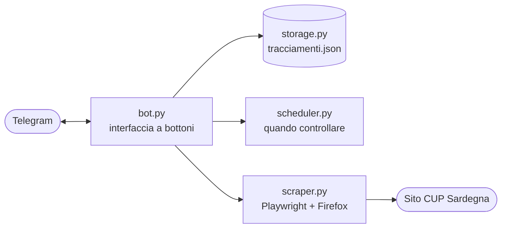

<h1 align="center">🩺 cupBot</h1>

<p align="center">
  <strong>Un bot Telegram che tiene d'occhio il CUP Sardegna al posto tuo<br>e ti avvisa quando compare un appuntamento.</strong>
</p>

<p align="center">
  
  
  
  
  
</p>

Progetto personale realizzato durante lo studio di Python per applicare quanto imparato.

Prenotare una visita sul sito del CUP Sardegna significa ricontrollare la pagina più volte al giorno, sperando che si liberi un posto. Questo bot lo fa in automatico: inserisci i dati della ricetta, scegli quanto spesso controllare e in quali ore, e ricevi un messaggio su Telegram con il risultato di ogni controllo.

## ✨ Cosa fa

- 📋 **Più tracciamenti attivi**, uno per ricetta, che puoi aggiungere, vedere e rimuovere in qualsiasi momento.
- 🔘 **Interfaccia a bottoni**: nessun comando da ricordare, a parte `/start`.
- 🗺️ **Filtri opzionali** per area e provincia, e un limite di tempo (entro quanti mesi vuoi l'appuntamento).
- ⏰ **Frequenza e fascia oraria per ogni tracciamento**: i controlli avvengono solo nelle ore che scegli, con un controllo poco dopo l'apertura della fascia e uno poco prima della chiusura.
- 🔎 **Controllo manuale** con un tocco, dal dettaglio di un tracciamento.
- 💬 **Un messaggio a ogni controllo**, sempre con il numero di ricetta: gli appuntamenti trovati oppure l'indicazione che non ce ne sono.
- 🤝 **Rispetto per il sito**: un controllo alla volta, pause casuali di 30-40 secondi tra un tracciamento e l'altro e piccoli ritardi casuali sull'orario dei controlli.
- 🔒 **Un solo utente autorizzato**: chiunque altro scriva al bot riceve "Non sei autorizzato".
- 🐳 **Pronto per Docker**: si avvia con un comando e i dati sopravvivono agli aggiornamenti.

> [!WARNING]
> **Avvertenze**
> Questo è un progetto personale, a scopo di studio e illustrativo. Non è affiliato né collegato in alcun modo alla Regione Autonoma della Sardegna o ai servizi CUP. Il software è fornito "così com'è", senza garanzie, come previsto dalla licenza MIT. L'autore non è responsabile dell'uso che ne viene fatto. Chi lo usa è tenuto a rispettare le condizioni d'uso del sito e a impostare frequenze di controllo ragionevoli. Il bot salva codice fiscale e numero di ricetta in chiaro in un file locale: chi lo installa è responsabile della protezione di quei dati.


## 🧭 Come si usa

1. Scrivi `/start` al bot e premi **Aggiungi tracciamento**.
2. Inserisci codice fiscale e numero di ricetta.
3. Scegli con i bottoni area, provincia (facoltative), entro quanti mesi cercare, ogni quante ore controllare e la fascia oraria.
4. Controlla il riepilogo e conferma.

Da quel momento il bot controlla da solo. Dal menu puoi **elencare** i tracciamenti, aprirne il dettaglio, lanciare un **controllo immediato** o **rimuoverli**. Subito dopo l'aggiunta di un tracciamento vengono controllati tutti.

## ⚙️ Come funziona



Ogni minuto un job controlla quali tracciamenti hanno bisogno di un controllo (in base a fascia oraria, frequenza e ultimo controllo). Lo scraper, che è sincrono, gira in un thread separato così il bot resta sempre reattivo mentre aspetta il sito. I tracciamenti sono salvati in un file JSON con scrittura sicura (file temporaneo e sostituzione atomica) e permessi ristretti.

## 🚀 Installazione con Docker

Requisiti: Docker con il plugin Compose.

```bash
git clone https://github.com/Oginexe/cupBot.git
cd cupBot
cp .env.example .env
```

Compila il file `.env`:

| Variabile | Cosa inserire |
|---|---|
| `TELEGRAM_BOT_TOKEN` | Il token del bot: lo ottieni scrivendo a [@BotFather](https://t.me/BotFather) con il comando `/newbot` |
| `ALLOWED_ID` | Il tuo ID Telegram numerico: lo ottieni scrivendo a [@userinfobot](https://t.me/userinfobot) |

Poi avvia:

```bash
chmod 600 .env
docker compose up -d --build
docker compose logs -f
```

Comandi utili:

| Operazione | Comando |
|---|---|
| Vedere i log | `docker compose logs -f` |
| Fermare il bot | `docker compose down` |
| Aggiornare dopo una modifica al codice | `git pull && docker compose up -d --build` |
| Copiare i tracciamenti fuori dal container | `docker compose cp cupbot:/app/data/tracciamenti.json ~/tracciamenti-backup.json` |

I tracciamenti sono nel volume Docker `tracciamenti`, quindi restano anche quando il container viene ricreato. Il comando `docker compose down -v` **cancella anche il volume**, e con lui tutti i tracciamenti.

Il container usa l'immagine ufficiale di Playwright, la cui versione deve coincidere con quella in `requirements.txt`. Lo sviluppo e la prova sono stati fatti su un server ARM64.

## 🛠️ Esecuzione in locale (sviluppo)

Serve Python 3.10 o superiore.

```bash
python -m venv .venv
source .venv/bin/activate
pip install -r requirements.txt
python -m playwright install firefox
cp .env.example .env    # poi compila il file
python bot.py
```

Non tenere acceso lo stesso bot in due posti insieme: Telegram permette a un solo programma alla volta di ricevere gli aggiornamenti di un bot.

## 🗂️ Struttura del progetto

| File | Cosa fa |
|---|---|
| `bot.py` | Interfaccia Telegram, flusso a bottoni, esecuzione dei controlli |
| `scraper.py` | Interroga il sito del CUP con Playwright e filtra gli appuntamenti per data |
| `scheduler.py` | Decide quando è ora di controllare un tracciamento |
| `storage.py` | Salva e legge i tracciamenti in `data/tracciamenti.json` |
| `validazione.py` | Controlli su codice fiscale e numero di ricetta |
| `parsing.py` | Normalizza il testo inserito e calcola la data limite |
| `dizionari.py` | Aree, province e codici usati dal sito |
| `Dockerfile`, `compose.yaml` | Esecuzione in container |
| `.env.example` | Modello del file di configurazione |

## 📌 Limiti noti e possibili sviluppi

- Il codice fiscale deve avere 9 lettere e 7 numeri: i rari codici "omocodici" non vengono accettati.
- Il limite di tempo conta 30 giorni per mese, quindi è approssimato di qualche giorno.
- Non c'è ancora un filtro per località dell'ambulatorio. Filtra solo per area e provincia.

## 📄 Licenza

Distribuito con licenza [MIT](LICENSE).
